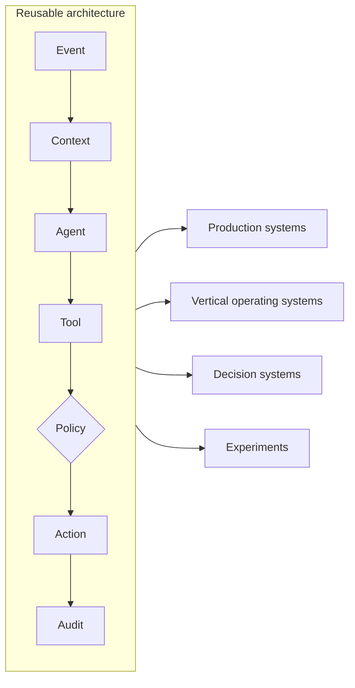

# Praxia — Selected Systems & Experiments

**Agentic operating systems, vertical SaaS and AI-native products built around real business workflows.**

> One architecture. Multiple operating environments.

Praxia turns data, processes, AI models and agents into operating systems for real business workflows. This repository is a curated set of case studies: what we built, the problem it solves, how it is structured, and its status. It contains **no product source code**. The open part of our technology lives in [praxia-agent-core](https://github.com/praxia-atelier/praxia-agent-core).

Every case states its status honestly: **production**, **prototype** or **experiment**. All names, figures and screenshots in this repository are synthetic.

---

## Production systems

| Case | What it proves | Status |
|---|---|---|
| [Field Services Operating System](cases/field-services-os) | AI agents running on real email and documents inside a service business's daily operations, with human approval | **Production** · architecture inspired by a production deployment |
| [Praxia Revenue Operating System](cases/praxia-revenue-os) | We run our own commercial process on the systems we build | **Production** · internal |

## Reusable architecture

| Project | What it proves | Status |
|---|---|---|
| [Praxia Agent Core](https://github.com/praxia-atelier/praxia-agent-core) | The core pattern (events, agents, tools, autonomy policies, audit) as an open-source runtime | Open source · v0.1 |

## Vertical operating systems

| Case | What it proves | Status |
|---|---|---|
| [Hospitality & Venue Operating System](cases/hospitality-venue-os) | Modeling a physical operation end to end: management, staff, suppliers, reservations, finance and guest reputation | Prototype |
| [Real Estate Operating System](cases/real-estate-os) | Segmented acquisition, qualification and an administrative flow up to contract | Prototype |
| [Commercial & Field Sales Operating System](cases/commercial-field-sales-os) | Multi-department management with business simulators | Prototype |

## Decision systems

| Case | What it proves | Status |
|---|---|---|
| [Matching & Decision Systems](cases/matching-decision-systems) | Turning structured and conversational input into explained, ranked recommendations | Production pattern · prototypes |

## Experiments

| Case | What it proves | Status |
|---|---|---|
| [Multimodal AI pipeline](cases/multimodal-pipeline) | Orchestrating text, voice, image and video models behind interchangeable providers | Internal tool · experiment |

---

## What is open and what is not

| Open | Not open |
|---|---|
| Agent Core runtime, interfaces, basic providers, examples | Product source code, data models, prompts, scoring, pricing, integrations, multi-tenant and white-label infrastructure |
| Architecture diagrams and case studies in this repository | Customer data, customer names, production screenshots |

## About Praxia

Praxia builds intelligent operating systems for real businesses. [praxia-atelier.net](https://praxia-atelier.net)

---

© 2026 REACTION CONTROL SL (Praxia Atelier). Case studies and diagrams in this repository are provided for information only; all rights reserved. Product names, figures and visuals are illustrative.
