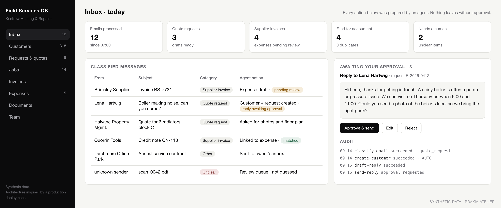
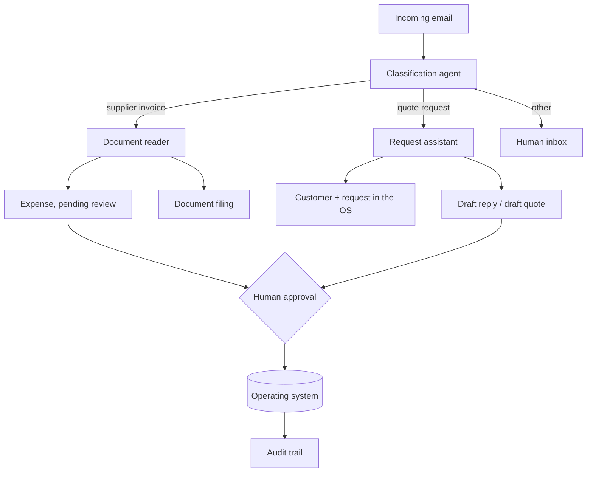

# Field Services Operating System

**Status: production.** *Architecture inspired by a production deployment.* All names, figures and visuals on this page are synthetic.

*Screenshot rebuilt with synthetic data for this case study.*

## Problem

A field service business (installations, repairs, on-site work) runs on email, phone photos, paper quotes and supplier invoices. The owner spends evenings typing data from one place into another, quote requests wait for days, and supplier invoices pile up until the quarterly deadline with the accountant.

## Architecture

## Modules

Customers · Requests and quotes · Jobs (photos, measurements, steps, time) · Invoices (drafts for the accountant) · Expenses · Documents · Inbox · Team

## Agent roles

| Agent | Does | Never does |
|---|---|---|
| Classification agent | Sorts incoming email and attachments into a small set of categories | Delete or mark anything as read |
| Document reader | Turns supplier documents into structured expense drafts, flags uncertain fields, checks totals | Guess a supplier or a customer |
| Request assistant | Creates the customer and request, gathers missing details, prepares a draft | Send prices without approval |
| Filing agent | Files originals with consistent names and avoids duplicates | Overwrite or move originals it is unsure about |

## Human approvals

- Every outbound quote and every reply that commits the business is approved by a person.
- Every expense extracted from a document is created as *pending review*.
- Anything ambiguous goes to a review queue instead of being guessed.

## Outcome categories

Less manual data entry · faster first response to quote requests · documents ready for the accountant without a quarterly rush · one place for customers, jobs and paperwork.

*(No metrics are published for this deployment.)*

## Technology (safe summary)

Mobile-first web app · managed Postgres · serverless functions · LLMs with structured, validated output · deterministic code for every amount.

## What is not here

Source code, data model, prompts, pricing and estimation logic, integrations, customer names or data, production screenshots. The reusable core of the pattern is open in [praxia-agent-core](https://github.com/praxia-atelier/praxia-agent-core) (see its inbox and quote examples).
