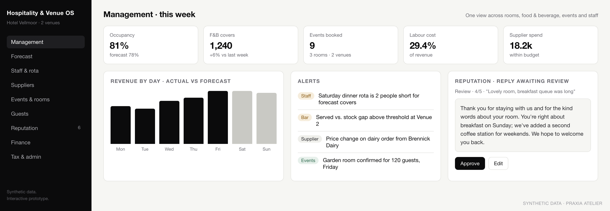
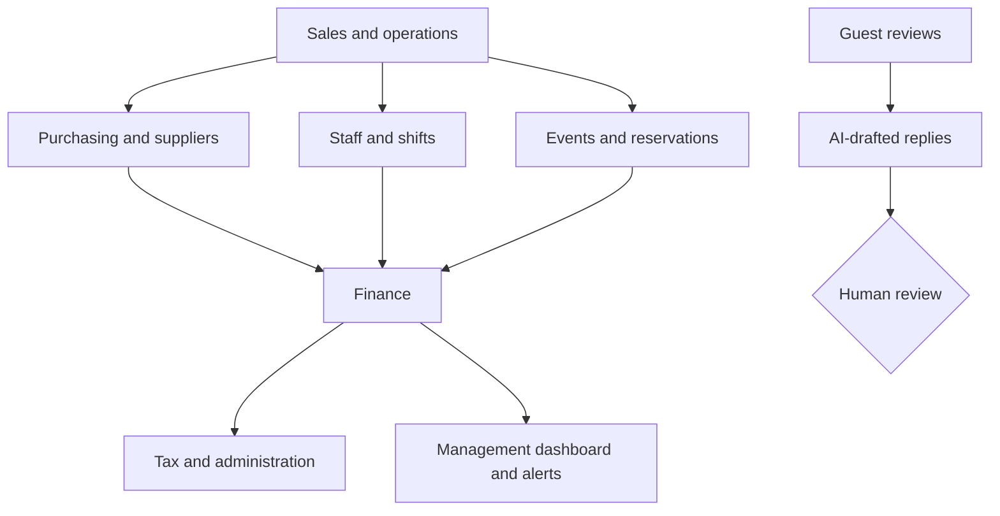

# Hospitality & Venue Operating System

**Status: prototype.** Interactive prototype with synthetic data. Integrations and AI features are designed and partly simulated, not deployed.

*Screenshot rebuilt with synthetic data for this case study.*

## Problem

Hotels, restaurants and event venues run on disconnected tools: point of sale, bookings, staff rotas, supplier invoices, spreadsheets for finance. Management sees the numbers weeks late.

## Architecture

## Modules

Executive dashboard · forecast and budget · staff, rota and labour cost · suppliers and purchasing · consumption control · events, reservations and room booking · guest CRM · reputation inbox · finance · tax and administration · alerts · ROI

## What it demonstrates

The capability is not "a restaurant dashboard". It is modeling and connecting finance, operations, staffing, suppliers, reservations and management information inside one sector-specific operating system, with AI where it saves time (drafting replies, summarizing reviews) and people where decisions matter.

## What is not here

Source code, customer data, real venues, pricing or cost models.
