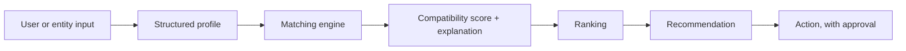

# Matching & Decision Systems

**Status: production pattern, prototypes.** Praxia builds decision engines that transform structured and conversational input into ranked, explained recommendations and operational next actions.

## Architecture

The input can be a form, or a conversation (chat or voice) that a model turns into structured fields. The score is computed by code, and every score comes with its reasons.

## Domains we have applied it to

| Entity A | Entity B | Objective |
|---|---|---|
| Community members | Members and experts | Useful introductions |
| Investors | Assets | Fit between investment thesis and opportunity |
| Property seekers | Properties | Shortlists that match must-haves and nice-to-haves |
| Households | Service professionals | Compatible, available professionals |

## Interface (conceptual)

`InputProfile` · `Candidate` · `MatchingCriteria` (hard filters, weighted criteria, bonuses) · `Score` · `Explanation` · `Ranking`

## What is not here

Production criteria, weights, thresholds, extraction prompts, data or profiles. A small synthetic example with invented weights is planned for the open-source examples.
