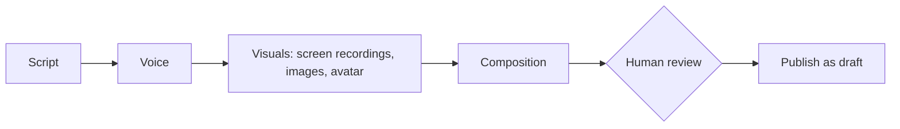

# Multimodal AI pipeline (experiment)

**Status: internal tool, experiment.** Architecture and sample output only.

Each stage sits behind a provider interface with fallback, so models can be swapped without rewriting the pipeline. Generated content is always reviewed before publishing.

Not included: provider selection logic, cost optimization, templates, styles, voices or source code.
