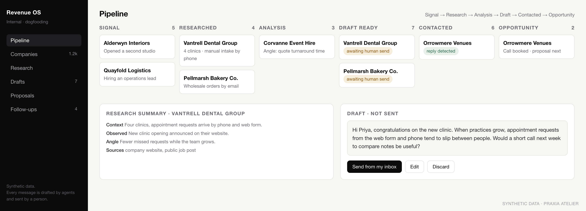
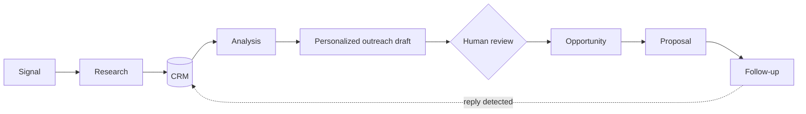

# Praxia Revenue Operating System

**Status: production, internal.** Praxia runs its own commercial process on this system. All visuals on this page use synthetic data.

*Screenshot rebuilt with synthetic data for this case study.*

## Problem

A small team cannot research, qualify, write to and follow up with every relevant company by hand, and generic sales tools automate volume, not judgement.

## Architecture

## What agents do

- **Research agents** gather public context about a company and populate the CRM.
- **Analysis agents** summarize fit and suggest an angle for the conversation.
- **Writing agents** draft personalized messages and proposals.
- **Follow-up agents** notice replies and keep the pipeline current.

## Human control

Nothing is sent automatically. Every message is drafted by the system and sent by a person. Previous versions of rewritten messages are kept.

## Why it matters

This is where Praxia's patterns are tested first: if a workflow is not useful to us, it does not reach a customer.

## What is not here

Source code, CRM data model, prompts, qualification and scoring criteria, channels and timing, data sources, contacts or any real lead.
